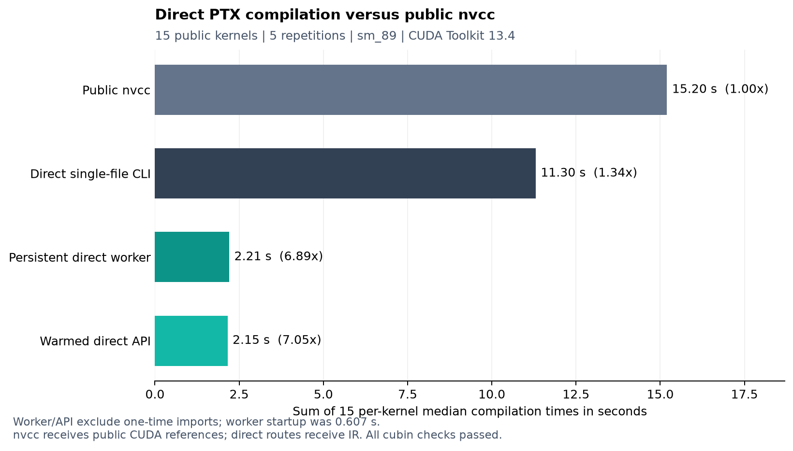

# Code review and compilation benchmark

This review covers the command-line wrapper, the complete PTX backend, local
GPU validation, synthetic regressions and the benchmark harness. Six additional
regression tests reproduced defects in the initial implementation. All six have
been fixed. The compiler also adds a persistent JSON-line worker and conservative
integer-expression optimizations. The original single-file submission command
remains available.

## Findings and fixes

| Priority | Finding in the initial implementation | Fix and regression coverage |
| --- | --- | --- |
| P1 | Loop-local `Let`, `Load` and `Assign` names used the enclosing environment's registers. A nested loop could overwrite a value that must remain visible afterward. The reproduction returned 9 instead of 2. | `Compiler.loop` creates a lexical value environment and exports only carried accumulators. `test_nested_loop_local_does_not_overwrite_outer_value` runs the reproduction on a GPU. |
| P1 | `Let.dtype` was ignored. An integer literal declared as f32 was placed in an integer register and stored as float bits, yielding the wrong numeric value. | `typed_value` performs supported integer/float conversions and float stores require float operands. Two regressions cover conversion and invalid mixed-type storage. |
| P1 | Predicate equality and predicate-valued ternaries generated unsupported `setp.*.pred` and `selp.pred` forms. ptxas rejected the generated kernel. | Equality uses predicate XOR and inversion; a predicate select uses predicate AND, inversion and OR. The new nested-predicate fixture assembles and executes. |
| P2 | Integer `/`, `//` and `%` emitted PTX truncating division/remainder. Emmy's expression evaluator defines floor division and divisor-signed modulo, which differ for negative intermediate indices. | `integer_divmod` corrects nonzero remainders when signs differ. Safe nonnegative intervals use the shorter division path. A GPU fixture covers all three operators with negative intermediate coordinates and valid final addresses. |
| P2 | A static zero stride was accepted, generating a loop that could never advance if executed. | Reject nonpositive static strides before writing PTX. The regression deliberately checks compilation only, avoiding execution of an infinite loop. Runtime strides must still satisfy the supported positive-stride contract. |
| P2 | `zip` silently truncated mismatched reduction component lists. A malformed shuffle could omit state without a useful diagnostic. | Validate component counts for both shuffles and shared trees. A negative test requires an explicit error. |

An additional review of shared-memory lifetime found a possible scratch-reuse
race: the tree synchronized writes before its final broadcast loads, but a fast
thread could start reusing that scratch before slower threads finished reading.
A barrier now follows the broadcast. This is a dependency-based finding; no
public-fixture hardware failure was observed from it.

During optimization, a regression check also caught an unsafe first version of
literal caching: Python dictionary keys equate positive and negative zero. The
final cache keys are encoded float32 bit patterns, so signed zero is preserved.
This issue was introduced and resolved during the review, not attributed to the
initial implementation.

Final validation passed all 14 unittest methods with GPU execution enabled,
all 15 public problems through the official RTX 5090 runner using the required
single-file command, and all 90 cubin/output comparisons from the benchmark
routes. The final official log is retained in
`build/remote-validation-after-review.txt` in this checkout.

## Compile-time opportunities implemented

The largest avoidable cost is repeated process startup and imports. Import
tracing showed substantial time in NumPy and Emmy's package initialization,
including modules that the direct backend does not itself invoke. Changing
Emmy's loader or bypassing its typed classes would conflict with the task's
deserialization requirement, so this project keeps that loader and amortizes the
imports through `python compile.py --worker` or the existing in-process API.

The worker reads one JSON object per input line and returns one JSON object per
request, flushing each response immediately. It reloads IR and metadata for every
request; it does not memoize complete kernels or their outputs. A failed request
returns an error object and does not prevent later valid requests. The startup
cost is measured separately in the benchmark.

Additional backend changes are deliberately limited to integer expressions and
bookkeeping:

- Fold integer constants and remove identities such as adding zero or multiplying
  by one, avoiding unnecessary virtual registers and PTX text.
- Reuse repeated pure subexpressions within one expression. This cache never
  crosses an assignment, loop edge or conditional body.
- Track conservative signed integer intervals for tile and loop coordinates.
  The fast floor-division path is selected only when signs are proven safe and
  interval arithmetic remains within signed 32-bit bounds.
- Allocate slotted immutable operand objects, reuse opcode tables and use a
  bounded cache of encoded literal operands.

Floating-point expressions are not reassociated or simplified with integer
identities. For example, replacing float multiplication by zero could change
NaN or signed-zero behavior. The fixes and optimizations retain the float32
rounding choices already used by this backend.

## Benchmark method

The comparison uses the installed public NVIDIA CUDA Toolkit 13.4 compiler,
version V13.4.92, and its matching ptxas. Both paths target `sm_89`. Every public
kernel is compiled to a cubin, with five measured repetitions per route and one
excluded warmup. Jobs are shuffled with the recorded fixed seed across routes
and kernels. OS file caches remain warm; a fresh-process measurement is not a
machine-reboot cold-cache measurement.

The nvcc route compiles the repository's public `*.ref.cu` source using
`nvcc --cubin -O3 -arch=sm_89`. On Windows the MSVC developer environment is
prepared once outside timing and `--use-local-env` avoids charging nvcc for
repeated environment setup. These are documented public
[nvcc phase and environment options](https://docs.nvidia.com/cuda/cuda-compiler-driver-nvcc/).
No private compiler or internal nvcc phase executable is used.

The direct routes lower the IR, write PTX and invoke
`ptxas -O3 -arch=sm_89`. Their total includes the PTX write and assembler
subprocess. Starting points differ intentionally: the direct path starts with
IR, while nvcc receives already generated CUDA C++. Excluding IR-to-CUDA
rendering favors nvcc and avoids invoking an existing lowering implementation
inside this compiler.

These are the delivered compilation paths, not identical native instruction
streams. In particular, this backend retains runtime loops for unroll hints,
while nvcc can unroll the reference source. Kernel execution speed was not timed;
numeric output correctness was checked independently for every route.

| Route | Timed work |
| --- | --- |
| `cli` | Fresh Python process, imports, IR load/lowering, PTX write and ptxas |
| `worker` | Request/response through an already running compiler, IR load/lowering, PTX write and ptxas |
| `api` | In-process `compile_file`, including IR/metadata reads, PTX write and ptxas; imports excluded |
| `nvcc` | One public nvcc process producing a cubin from the supplied CUDA reference |
| `baseline_cli` | Initial compiler snapshot, using the same fresh-process protocol and ptxas |
| `baseline_api` | Initial compiler snapshot, using the same warmed API protocol and ptxas |

The initial compiler snapshot was copied before review changes. Reports record
its backend hash, final compiler/backend hashes, benchmark hash and hashes of
every IR and CUDA reference. The same tool binaries and prepared environment are
used for all routes. GPU execution and output comparisons occur after timed
compilation and are excluded from compile-time measurements.

Per-kernel results use the median and report the interquartile range, minimum
and maximum. The suite comparison divides sums of per-kernel medians; the report
also includes a geometric mean of per-kernel speedups. These two statistics are
kept distinct. Process timings include normal OS scheduling and filesystem
variation; this is one Windows workstation, not a cross-platform performance
guarantee or a GPU runtime benchmark.

## Measured results from October 22 2026

The host was Windows 11 build 26200 on an Intel Family 6 Model 186 CPU, with Python 3.14.5 and Emmy 0.3.11. GPU verification used the NVIDIA RTX 3500 Ada Generation Laptop GPU. The public toolchain was CUDA Toolkit 13.4 V13.4.92. All 90 route/output checks passed. There are 450 measured samples plus 90 excluded warmup samples.

| Compilation route | Sum of 15 per-kernel median times | Speedup over nvcc |
| --- | --- | --- |
| Public nvcc | 15.201 s | 1.00x |
| Direct single-file CLI | 11.303 s | 1.34x |
| Persistent direct worker | 2.206 s | 6.89x |
| Warmed direct API | 2.155 s | 7.05x |
| Initial single-file CLI | 11.274 s | 1.35x |
| Initial warmed API | 2.225 s | 6.83x |

Worker startup plus its first request took **0.607 seconds**, outside steady-request timings. Adding that measured one-time cost to the sum of worker medians gives a derived 15-kernel total of 2.813 seconds, or 5.40x versus nvcc; this is an amortization illustration, not a separately measured suite run.

The mandatory fresh-process CLI achieves **1.34x** in this environment. The larger **6.89x worker** and **7.05x API** results require a caller that retains its process. This experiment does not reproduce the README's approximately 19x claim.



### Results for every public kernel

All entries are median milliseconds, including native assembly.

| Problem | Public nvcc | Single-file CLI | Worker | Warm API |
| --- | --- | --- | --- | --- |
| `a01_attention` | 1114.23 | 834.18 | 232.79 | 234.79 |
| `a02_attention_128` | 1040.57 | 757.30 | 144.37 | 138.19 |
| `f01_rmsnorm` | 1008.55 | 753.22 | 139.58 | 129.45 |
| `f02_row_softmax` | 1006.64 | 765.46 | 177.37 | 169.83 |
| `f03_l2norm` | 986.48 | 755.23 | 139.22 | 137.81 |
| `m01_matmul_512` | 1141.69 | 784.02 | 188.44 | 186.56 |
| `m02_matmul_rect` | 1002.38 | 711.54 | 128.18 | 138.13 |
| `p00_scalar_add` | 974.58 | 772.52 | 125.22 | 129.11 |
| `p01_vector_add` | 963.38 | 720.99 | 119.97 | 125.99 |
| `p02_scale_shift` | 991.59 | 792.30 | 129.00 | 128.68 |
| `p03_relu_mul` | 991.70 | 721.13 | 124.44 | 117.16 |
| `r01_array_sum` | 998.26 | 743.40 | 156.42 | 123.02 |
| `r02_big_sum` | 996.80 | 710.16 | 127.57 | 129.00 |
| `r03_mean` | 995.29 | 741.32 | 138.73 | 135.46 |
| `r04_row_sum` | 988.46 | 739.81 | 134.80 | 131.79 |

### What changed relative to the initial compiler

Generated ASCII PTX decreased from 102,930 to 87,848 bytes, a **14.7% reduction**. This is the generated string size before platform newline translation. Warmed API lowering alone totaled 55.20 ms before review and 56.71 ms afterward across case medians. The additional validation and signed-arithmetic handling did not improve Python lowering time in this run.

The warmed API end-to-end median sum fell from 2.225 s to 2.155 s, while fresh-process compilation moved from 11.274 s to 11.303 s. These small differences are comparable to run-to-run variation; they are not evidence of a reliable one-shot speedup from backend micro-optimizations. The material change is exposing persistent compilation, which avoids approximately 0.6 s of repeated Python/import work per variant on this host. Assembly still dominates the persistent path.

### Raw evidence

[Full JSON report with every sample, hashes, versions and GPU checks](benchmarks/compile_times_2026-10-22.json) and [CSV of every route's median, spread and stage timings](benchmarks/compile_times_2026-10-22.csv) are checked in with this report. The original run artifacts remain under `build/benchmark-final/`.

Final backend SHA256: `aac65241768e2cd188ddf2e91712000becf0a4a33247ec897e811eea8ec150d1`. Initial backend SHA256: `e8233234c926b122e0d6641d6cc3f083e0a4310b9a72847b1334ec11b43ac708`.


## Reproduce the measurements

Install `requirements.txt`, put ptxas and nvcc on PATH, and use Python 3.12 or
newer. On Windows, install the MSVC x64 C++ tools; the harness discovers them
through `vswhere`, or accepts `--vcvars` with a `VsDevCmd.bat` path.

```bash
python tools/benchmark.py --repetitions 5 --warmups 1 --verify
```

To compare another revision, provide an isolated copy of that revision's
`compile.py` and `emmy_ptx.py`:

```bash
python tools/benchmark.py --repetitions 5 --warmups 1 --verify \
  --baseline-compiler path/to/previous/compile.py
```

The second example uses POSIX line continuation; on PowerShell keep the command
on one line or use its backtick continuation. The baseline used for this review
is retained in `build/review-baseline/` in this working checkout.

The harness writes `build/benchmark/report.json`, raw `samples.jsonl`, PTX and
cubins. Warmup samples are marked and excluded from summaries. `--verify` requires
an NVIDIA GPU supporting the selected architecture and checks generated cubins
against the problem's original expected outputs and tolerances.

## Persistent integration

The evaluator's exact single-file invocation still produces plain PTX:

```bash
python compile.py path/to/kernel.ir.json > out.ptx
```

For an autotuner that already runs Python, import `compile_file` once and call
it for each variant. A caller in another language can keep this process open:

```bash
python compile.py --worker
```

Send a line such as
`{"ir":"problems/r01_array_sum/k_sum_1_reduce.ir.json"}`. Read the response line
before sending the next request; on success it has `ok: true` and a `ptx` string.
Relative paths are resolved in the worker's working directory. Close stdin to
shut down cleanly. Single-file stdout remains raw PTX; worker stdout is the
explicit JSON protocol. The existing `submit.py` uses the single-file interface
and does not automatically benefit from worker amortization.

## Remaining opportunities and limits

1. Integrating the worker/API into Emmy's autotuner would avoid fresh imports for
   every variant. This repository supplies the interface; upstream integration
   is not part of the benchmark or the hackathon's one-file evaluator contract.
2. An upstream Emmy release with lighter package initialization could improve
   the one-shot command. This project does not patch dependency internals.
3. A parsed-IR or cubin cache could help exact repeated inputs, but this benchmark
   deliberately recompiles each sample. A cache-hit speed is not a substitute
   for compiling novel autotuning variants.
4. Compilation concurrency could improve throughput across independent variants.
   The measurements here are sequential per-kernel latency; they do not claim
   a parallel throughput speedup.
5. After imports are amortized, assembler invocations dominate the measured
   pipeline. NVIDIA's [PTX Compiler API](https://docs.nvidia.com/cuda/ptx-compiler-api/index.html)
   accepts PTX strings and returns a loadable native image. An optional in-process
   assembly integration could avoid process and file overhead; its benefit is
   unmeasured here. The current required path continues to feed PTX to ptxas.

Static float32 buffers, supported scalar operations, one-dimensional launches,
and signed 32-bit indexing remain the implementation boundary. Tensor cores,
TMA, dynamic shapes, serial runtime axes, software shared-memory swizzles and
by-value scalar ABI entries remain unsupported. Runtime loop strides must be
positive. Inputs must be trusted scheduled Emmy IR: the mandated upstream
deserializer evaluates serialized constructors and is not an untrusted-input
security boundary. The hidden evaluation set and broader numeric edge cases
have not been tested.
